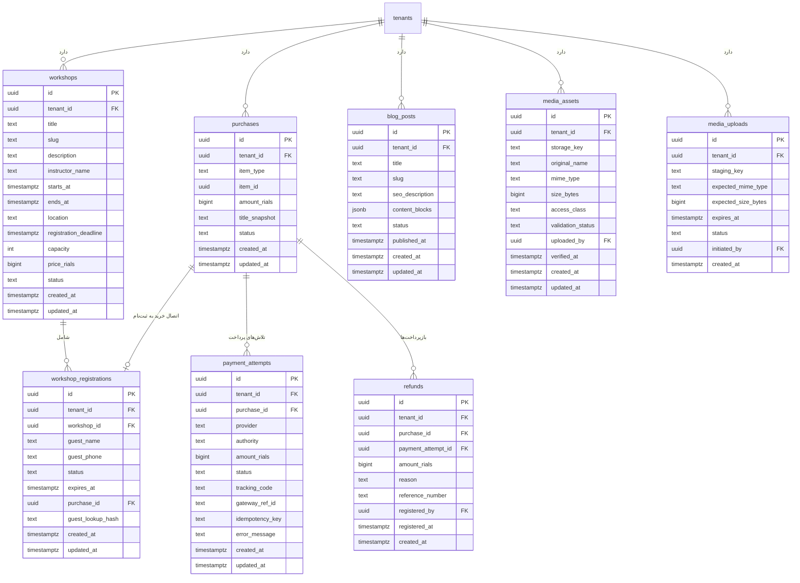

# راهنمای پایگاه داده و Schema مسیر روان‌شناسی

> این سند مرجع حقیقت ساختار پایگاه داده، قیدها، امنیت RLS و ترتیب قفل‌ها برای پلتفرم روان‌شناسی است.
> تمامی Migrationها و کوئری‌های `sqlc` باید به این سند و [الگوی Migration و RLS](../../patterns/02-migration-rls.md) وفادار باشند.

---

## ۱. قراردادهای سراسری (Global Conventions)

| موضوع | قرارداد الزامی | دلیل و کاربرد |
| --- | --- | --- |
| **شناسه‌ها (IDs)** | `UUID v4` با `DEFAULT gen_random_uuid()` | یکتایی بدون وابستگی به شماره‌انداز متمرکز و جلوگیری از حدس‌زدن IDها |
| **زمان‌ها** | `timestamptz` | ذخیره زمان به صورت دقیق همراه با منطقه زمانی (همیشه در سطح کد به صورت UTC ذخیره و پردازش می‌شود) |
| **مبالغ مالی** | `bigint` (ریال) | جلوگیری قطعی از خطای ممیز شناور (float). نمایش در رابط کاربری به تومان است. |
| **نام‌گذاری** | `snake_case` انگلیسی و جمع برای جداول | مثال: `tenants`، `memberships`، `site_settings` |
| **حذف منطقی** | `deleted_at timestamptz` | در منابع مهم همراه با ایندکس‌های یکتای جزئی (`WHERE deleted_at IS NULL`) |

---

## ۲. قوانین امنیت داده و RLS (Row Level Security)

1. **تفکیک کامل Tenantها:**
   تمام جدول‌های داده‌ای کلینیک‌ها شامل ستون `tenant_id uuid NOT NULL REFERENCES tenants(id)` هستند.
2. **اجبار RLS:**
   تمام جدول‌های tenant-scoped دارای دو دستور زیر هستند:
   ```sql
   ALTER TABLE <table_name> ENABLE ROW LEVEL SECURITY;
   ALTER TABLE <table_name> FORCE ROW LEVEL SECURITY;
   ```
   دستور `FORCE` تضمین می‌کند که حتی مالک جدول (یا نقش‌های بدون Superuser) نیز مقید به policy هستند.
3. **الگوی Policy استاندارد:**
   ```sql
   CREATE POLICY tenant_isolation ON <table_name>
       USING      (tenant_id = NULLIF(current_setting('app.tenant_id', true), '')::uuid)
       WITH CHECK (tenant_id = NULLIF(current_setting('app.tenant_id', true), '')::uuid);
   ```
4. **کلیدهای خارجی ترکیبی (Composite FK):**
   برای جلوگیری از حملات ارجاع متقاطع بین دو مستاجر (Cross-Tenant Reference Attack)، هر جدول فرزند علاوه بر `tenant_id` مستقل خود، با کلید ترکیبی `(tenant_id, parent_id)` به والد ارجاع می‌دهد:
   ```sql
   -- روی والد:
   ALTER TABLE parents ADD CONSTRAINT parents_tenant_id_id_uq UNIQUE (tenant_id, id);
   -- روی فرزند:
   FOREIGN KEY (tenant_id, parent_id) REFERENCES parents (tenant_id, id) ON DELETE CASCADE
   ```

---

## ۳. ترتیب قفل‌ها و پیشگیری از Deadlock

1. **ترتیب قفل منابع:** در هر تراکنشی که نیاز به قفل چند ردیف دارد (مانند ثبت‌نام کارگاه یا رزرو نوبت):
   - همیشه ابتدا منبع والد (مثل کارگاه یا سانس نوبت‌دهی) قفل می‌شود و سپس ردیف فرزند ایجاد یا به‌روز می‌شود.
2. **مرتب‌سازی در عملیات دسته‌ای:** اگر چند ردیف هم‌زمان با `SELECT ... FOR UPDATE` قفل می‌شوند، حتماً بر اساس `id ASC` مرتب شوند.
3. **خروج تماس‌های شبکه از تراکنش:** هرگونه فراخوانی وب‌سرویس خارجی (درگاه زرین‌پال، پیامک، S3 پارس‌پک) **اکیداً خارج از تراکنش دیتابیس** انجام می‌شود.

---

## ۴. ساختار جداول هسته (Core Schema - فاز PSY-0)

### ۴.۱ جدول `tenants` (کلینیک‌ها / مطب‌ها)
```sql
CREATE TABLE tenants (
    id         uuid        PRIMARY KEY DEFAULT gen_random_uuid(),
    name       text        NOT NULL,
    slug       text        NOT NULL UNIQUE,
    status     text        NOT NULL DEFAULT 'active' CHECK (status IN ('active', 'suspended', 'archived')),
    created_at timestamptz NOT NULL DEFAULT now(),
    updated_at timestamptz NOT NULL DEFAULT now()
);
```

### ۴.۲ جدول `domains` (دامنه‌ها و زیردامنه‌ها)
هر کلینیک یک یا چند دامنه (زیردامنه پایلوت یا دامنه اختصاصی) دارد.
```sql
CREATE TABLE domains (
    id          uuid        PRIMARY KEY DEFAULT gen_random_uuid(),
    tenant_id   uuid        NOT NULL REFERENCES tenants(id) ON DELETE CASCADE,
    host        text        NOT NULL UNIQUE,
    is_primary  boolean     NOT NULL DEFAULT false,
    is_verified boolean     NOT NULL DEFAULT false,
    verified_at timestamptz,
    created_at  timestamptz NOT NULL DEFAULT now(),
    updated_at  timestamptz NOT NULL DEFAULT now()
);

CREATE INDEX domains_tenant_id_idx ON domains (tenant_id);

ALTER TABLE domains ENABLE ROW LEVEL SECURITY;
ALTER TABLE domains FORCE  ROW LEVEL SECURITY;

CREATE POLICY tenant_isolation ON domains
    USING      (tenant_id = NULLIF(current_setting('app.tenant_id', true), '')::uuid)
    WITH CHECK (tenant_id = NULLIF(current_setting('app.tenant_id', true), '')::uuid);
```

### ۴.۳ جدول `site_settings` (تنظیمات سایت و هویت بصری)
```sql
CREATE TABLE site_settings (
    tenant_id        uuid        PRIMARY KEY REFERENCES tenants(id) ON DELETE CASCADE,
    title            text        NOT NULL DEFAULT '',
    description      text        NOT NULL DEFAULT '',
    phone            text        NOT NULL DEFAULT '',
    address          text        NOT NULL DEFAULT '',
    primary_color    text        NOT NULL DEFAULT '#0284c7',
    logo_media_id    uuid,
    created_at       timestamptz NOT NULL DEFAULT now(),
    updated_at       timestamptz NOT NULL DEFAULT now(),
    template_id      text        NOT NULL DEFAULT 'minimal',
    template_version text        NOT NULL DEFAULT '1.0.0',
    theme_radius     text        NOT NULL DEFAULT 'md' CHECK (theme_radius IN ('sm', 'md', 'lg')),
    theme_scale      text        NOT NULL DEFAULT 'md' CHECK (theme_scale IN ('sm', 'md', 'lg')),
    palette_id       text        NOT NULL DEFAULT 'calm-sage' CHECK (palette_id IN ('calm-sage', 'ocean-trust', 'warm-sand', 'royal-plum', 'stitch-editorial')),
    home_profile     jsonb       NOT NULL DEFAULT '{}'::jsonb CHECK (jsonb_typeof(home_profile) = 'object'),
    portrait_media_id uuid
);

ALTER TABLE site_settings ENABLE ROW LEVEL SECURITY;
ALTER TABLE site_settings FORCE  ROW LEVEL SECURITY;

CREATE POLICY tenant_isolation ON site_settings
    USING      (tenant_id = NULLIF(current_setting('app.tenant_id', true), '')::uuid)
    WITH CHECK (tenant_id = NULLIF(current_setting('app.tenant_id', true), '')::uuid);
```

بازگشت migration شمارهٔ `000012` تا وقتی رکوردی از `stitch-editorial` استفاده می‌کند رد می‌شود. برای بازگشت، هر مطب باید ابتدا از مسیر مجاز انتشار ظاهر پالت دیگری انتخاب کند.

migration شمارهٔ `000013` دادهٔ اختیاری صفحهٔ اصلی و کلید خارجی ترکیبی `(tenant_id, portrait_media_id)` به `media_assets(tenant_id, id)` را اضافه می‌کند. حذف رسانه، فقط شناسهٔ پرتره را خالی می‌کند.

### ۴.۴ جدول `panel_identities` (کاربران پنل مدیریت کلینیک)
هویت کلی اعضای کادر درمان و پنل مدیریت (مستقل از اینکه در کدام کلینیک‌ها عضو هستند).
```sql
CREATE TABLE panel_identities (
    id            uuid        PRIMARY KEY DEFAULT gen_random_uuid(),
    email         text        NOT NULL UNIQUE,
    password_hash text        NOT NULL,
    full_name     text        NOT NULL,
    status        text        NOT NULL DEFAULT 'active' CHECK (status IN ('active', 'inactive')),
    created_at    timestamptz NOT NULL DEFAULT now(),
    updated_at    timestamptz NOT NULL DEFAULT now()
);
```

### ۴.۵ جدول `memberships` (عضویت و نقش در کلینیک)
تعیین نقش هر کاربر در هر کلینیک (`owner`، `content_manager`، `receptionist`، `therapist`).
```sql
CREATE TABLE memberships (
    id         uuid        PRIMARY KEY DEFAULT gen_random_uuid(),
    tenant_id  uuid        NOT NULL REFERENCES tenants(id) ON DELETE CASCADE,
    user_id    uuid        NOT NULL REFERENCES panel_identities(id) ON DELETE CASCADE,
    role       text        NOT NULL CHECK (role IN ('owner', 'content_manager', 'receptionist', 'therapist')),
    created_at timestamptz NOT NULL DEFAULT now(),
    updated_at timestamptz NOT NULL DEFAULT now(),
    CONSTRAINT memberships_tenant_user_uq UNIQUE (tenant_id, user_id)
);

ALTER TABLE memberships ENABLE ROW LEVEL SECURITY;
ALTER TABLE memberships FORCE  ROW LEVEL SECURITY;

CREATE POLICY tenant_isolation ON memberships
    USING      (tenant_id = NULLIF(current_setting('app.tenant_id', true), '')::uuid)
    WITH CHECK (tenant_id = NULLIF(current_setting('app.tenant_id', true), '')::uuid);
```

### ۴.۶ جدول `panel_sessions` (نشست‌های سمت سرور)
```sql
CREATE TABLE panel_sessions (
    id         uuid        PRIMARY KEY DEFAULT gen_random_uuid(),
    user_id    uuid        NOT NULL REFERENCES panel_identities(id) ON DELETE CASCADE,
    token_hash text        NOT NULL UNIQUE,
    expires_at timestamptz NOT NULL,
    created_at timestamptz NOT NULL DEFAULT now()
);

CREATE INDEX panel_sessions_token_hash_idx ON panel_sessions (token_hash);
CREATE INDEX panel_sessions_expires_at_idx ON panel_sessions (expires_at);
```

### ۴.۷ جدول `password_resets` (کدهای بازیابی رمز عبور)
```sql
CREATE TABLE password_resets (
    id         uuid        PRIMARY KEY DEFAULT gen_random_uuid(),
    user_id    uuid        NOT NULL REFERENCES panel_identities(id) ON DELETE CASCADE,
    code_hash  text        NOT NULL,
    expires_at timestamptz NOT NULL,
    used_at    timestamptz,
    created_at timestamptz NOT NULL DEFAULT now()
);

CREATE INDEX password_resets_user_id_idx ON password_resets (user_id);
```

---

## ۵. ساختار جداول فاز ۱ (PSY-1: کارگاه حضوری، پرداخت، بلاگ و رسانه)

### ۵.۱ نمودار ارتباط موجودیت‌ها (ERD)



---

### ۵.۲ جدول `workshops` (کارگاه‌های حضوری)

کارگاه تک‌رویداد حضوری با ظرفیت مشخص، مهلت ثبت‌نام، و مبلغ قطعی به ریال.

```sql
CREATE TABLE workshops (
    id                    uuid        PRIMARY KEY DEFAULT gen_random_uuid(),
    tenant_id             uuid        NOT NULL REFERENCES tenants(id) ON DELETE CASCADE,
    title                 text        NOT NULL,
    slug                  text        NOT NULL,
    description           text        NOT NULL DEFAULT '',
    instructor_name       text        NOT NULL,
    starts_at             timestamptz NOT NULL,
    ends_at               timestamptz NOT NULL,
    location              text        NOT NULL,
    registration_deadline timestamptz NOT NULL,
    capacity              integer     NOT NULL CHECK (capacity >= 1),
    price_rials           bigint      NOT NULL DEFAULT 0 CHECK (price_rials >= 0),
    status                text        NOT NULL DEFAULT 'draft' CHECK (status IN ('draft', 'published', 'closed', 'cancelled')),
    created_at            timestamptz NOT NULL DEFAULT now(),
    updated_at            timestamptz NOT NULL DEFAULT now(),
    CONSTRAINT workshops_tenant_id_id_uq UNIQUE (tenant_id, id),
    CONSTRAINT workshops_tenant_slug_uq UNIQUE (tenant_id, slug),
    CONSTRAINT workshops_dates_check CHECK (starts_at < ends_at AND registration_deadline <= starts_at)
);

CREATE INDEX workshops_tenant_status_idx ON workshops (tenant_id, status);
CREATE INDEX workshops_tenant_starts_at_idx ON workshops (tenant_id, starts_at);

ALTER TABLE workshops ENABLE ROW LEVEL SECURITY;
ALTER TABLE workshops FORCE  ROW LEVEL SECURITY;

CREATE POLICY tenant_isolation ON workshops
    USING      (tenant_id = NULLIF(current_setting('app.tenant_id', true), '')::uuid)
    WITH CHECK (tenant_id = NULLIF(current_setting('app.tenant_id', true), '')::uuid);
```

---

migration شمارهٔ `000014` ستون `topic` از نوع `text NOT NULL DEFAULT ''` با حداکثر ۸۰ نویسه را به کارگاه اضافه می‌کند. مقدار خالی یعنی کارگاه بدون موضوع است.

### ۵.۳ جدول `workshop_registrations` (ثبت‌نام‌ها و رزرو صندلی)

هر ردیف یک صندلی از کارگاه را نمایندگی می‌کند. ثبت‌نام رایگان بلافاصله `confirmed` شده و ثبت‌نام پولی `pending_payment` با مهلت انقضای ۱۵ دقیقه‌ای می‌گیرد.

```sql
CREATE TABLE workshop_registrations (
    id                uuid        PRIMARY KEY DEFAULT gen_random_uuid(),
    tenant_id         uuid        NOT NULL REFERENCES tenants(id) ON DELETE CASCADE,
    workshop_id       uuid        NOT NULL,
    guest_name        text        NOT NULL,
    guest_phone       text        NOT NULL,
    status            text        NOT NULL DEFAULT 'pending_payment' CHECK (status IN ('pending_payment', 'confirmed', 'cancelled', 'expired')),
    expires_at        timestamptz,
    purchase_id       uuid,
    guest_lookup_hash text        NOT NULL,
    created_at        timestamptz NOT NULL DEFAULT now(),
    updated_at        timestamptz NOT NULL DEFAULT now(),
    CONSTRAINT registrations_tenant_id_id_uq UNIQUE (tenant_id, id),
    CONSTRAINT registrations_workshop_fk FOREIGN KEY (tenant_id, workshop_id) REFERENCES workshops(tenant_id, id) ON DELETE CASCADE
);

-- ایندکس جهت جلوگیری از ثبت‌نام فعال تکراری برای یک شماره تماس در یک کارگاه
CREATE UNIQUE INDEX workshop_registrations_active_phone_uq
    ON workshop_registrations (tenant_id, workshop_id, guest_phone)
    WHERE status IN ('pending_payment', 'confirmed');

CREATE INDEX workshop_registrations_tenant_workshop_status_idx 
    ON workshop_registrations (tenant_id, workshop_id, status);

CREATE INDEX workshop_registrations_status_expires_at_idx 
    ON workshop_registrations (status, expires_at) 
    WHERE status = 'pending_payment';

CREATE INDEX workshop_registrations_lookup_hash_idx
    ON workshop_registrations (tenant_id, guest_lookup_hash);

ALTER TABLE workshop_registrations ENABLE ROW LEVEL SECURITY;
ALTER TABLE workshop_registrations FORCE  ROW LEVEL SECURITY;

CREATE POLICY tenant_isolation ON workshop_registrations
    USING      (tenant_id = NULLIF(current_setting('app.tenant_id', true), '')::uuid)
    WITH CHECK (tenant_id = NULLIF(current_setting('app.tenant_id', true), '')::uuid);
```

---

### ۵.۴ جدول `purchases` (خریدها و سفارشات مالی)

شناسه خرید منبع حقیقت مالی ثبت‌نام کارگاه یا دوره‌های آموزشی است و عنوان و مبلغ را اسنپ‌شات می‌کند.

```sql
CREATE TABLE purchases (
    id             uuid        PRIMARY KEY DEFAULT gen_random_uuid(),
    tenant_id      uuid        NOT NULL REFERENCES tenants(id) ON DELETE CASCADE,
    item_type      text        NOT NULL CHECK (item_type IN ('workshop', 'course')),
    item_id        uuid        NOT NULL,
    amount_rials   bigint      NOT NULL CHECK (amount_rials > 0),
    title_snapshot text        NOT NULL,
    status         text        NOT NULL DEFAULT 'pending' CHECK (status IN ('pending', 'completed', 'refund_required', 'refunded', 'failed')),
    created_at     timestamptz NOT NULL DEFAULT now(),
    updated_at     timestamptz NOT NULL DEFAULT now(),
    CONSTRAINT purchases_tenant_id_id_uq UNIQUE (tenant_id, id)
);

CREATE INDEX purchases_tenant_status_idx ON purchases (tenant_id, status);
CREATE INDEX purchases_tenant_item_idx ON purchases (tenant_id, item_type, item_id);

ALTER TABLE purchases ENABLE ROW LEVEL SECURITY;
ALTER TABLE purchases FORCE  ROW LEVEL SECURITY;

CREATE POLICY tenant_isolation ON purchases
    USING      (tenant_id = NULLIF(current_setting('app.tenant_id', true), '')::uuid)
    WITH CHECK (tenant_id = NULLIF(current_setting('app.tenant_id', true), '')::uuid);
```

---

### ۵.۵ جدول `payment_attempts` (تلاش‌های پرداخت درگاه)

ثبت تراکنش درگاه با کلید یکتای Idempotency و شناسه Authority ارائه‌دهنده (زرین‌پال).

```sql
CREATE TABLE payment_attempts (
    id              uuid        PRIMARY KEY DEFAULT gen_random_uuid(),
    tenant_id       uuid        NOT NULL REFERENCES tenants(id) ON DELETE CASCADE,
    purchase_id     uuid        NOT NULL,
    provider        text        NOT NULL DEFAULT 'zarinpal' CHECK (provider IN ('zarinpal', 'mock')),
    authority       text        NOT NULL,
    amount_rials    bigint      NOT NULL CHECK (amount_rials > 0),
    status          text        NOT NULL DEFAULT 'initiated' CHECK (status IN ('initiated', 'verified', 'failed')),
    tracking_code   text,
    gateway_ref_id  text,
    idempotency_key text        NOT NULL,
    error_message   text,
    created_at      timestamptz NOT NULL DEFAULT now(),
    updated_at      timestamptz NOT NULL DEFAULT now(),
    CONSTRAINT payment_attempts_tenant_id_id_uq UNIQUE (tenant_id, id),
    CONSTRAINT payment_attempts_purchase_fk FOREIGN KEY (tenant_id, purchase_id) REFERENCES purchases(tenant_id, id) ON DELETE CASCADE,
    CONSTRAINT payment_attempts_tenant_authority_uq UNIQUE (tenant_id, authority),
    CONSTRAINT payment_attempts_tenant_idempotency_uq UNIQUE (tenant_id, idempotency_key)
);

CREATE INDEX payment_attempts_tenant_purchase_idx ON payment_attempts (tenant_id, purchase_id);

ALTER TABLE payment_attempts ENABLE ROW LEVEL SECURITY;
ALTER TABLE payment_attempts FORCE  ROW LEVEL SECURITY;

CREATE POLICY tenant_isolation ON payment_attempts
    USING      (tenant_id = NULLIF(current_setting('app.tenant_id', true), '')::uuid)
    WITH CHECK (tenant_id = NULLIF(current_setting('app.tenant_id', true), '')::uuid);
```

---

### ۵.۶ جدول `refunds` (ثبت بازپرداخت‌های مالی)

برای مواردی که پرداخت پس از انقضا یا لغو کارگاه با موفقیت تایید شده و وارد وضعیت `refund_required` شده است.

```sql
CREATE TABLE refunds (
    id                 uuid        PRIMARY KEY DEFAULT gen_random_uuid(),
    tenant_id          uuid        NOT NULL REFERENCES tenants(id) ON DELETE CASCADE,
    purchase_id        uuid        NOT NULL,
    payment_attempt_id uuid,
    amount_rials       bigint      NOT NULL CHECK (amount_rials > 0),
    reason             text        NOT NULL,
    reference_number   text        NOT NULL,
    registered_by      uuid        NOT NULL REFERENCES panel_identities(id),
    registered_at      timestamptz NOT NULL DEFAULT now(),
    created_at         timestamptz NOT NULL DEFAULT now(),
    CONSTRAINT refunds_tenant_purchase_fk FOREIGN KEY (tenant_id, purchase_id) REFERENCES purchases(tenant_id, id) ON DELETE CASCADE,
    CONSTRAINT refunds_tenant_reference_uq UNIQUE (tenant_id, reference_number)
);

CREATE INDEX refunds_tenant_purchase_idx ON refunds (tenant_id, purchase_id);

ALTER TABLE refunds ENABLE ROW LEVEL SECURITY;
ALTER TABLE refunds FORCE  ROW LEVEL SECURITY;

CREATE POLICY tenant_isolation ON refunds
    USING      (tenant_id = NULLIF(current_setting('app.tenant_id', true), '')::uuid)
    WITH CHECK (tenant_id = NULLIF(current_setting('app.tenant_id', true), '')::uuid);
```

---

### ۵.۷ جدول `blog_posts` (مطالب بلاگ)

مطالب بلاگ شامل عنوان، اسلاگ یکتا در سطح کلینیک، توضیحات سئو و بلوک‌های ساخت‌یافته و ایمن (JSONB بدون امکان اجرای کد یا HTML خام).

```sql
CREATE TABLE blog_posts (
    id              uuid        PRIMARY KEY DEFAULT gen_random_uuid(),
    tenant_id       uuid        NOT NULL REFERENCES tenants(id) ON DELETE CASCADE,
    title           text        NOT NULL,
    slug            text        NOT NULL,
    seo_description text        NOT NULL DEFAULT '',
    content_blocks  jsonb       NOT NULL DEFAULT '[]'::jsonb,
    status          text        NOT NULL DEFAULT 'draft' CHECK (status IN ('draft', 'published')),
    published_at    timestamptz,
    created_at      timestamptz NOT NULL DEFAULT now(),
    updated_at      timestamptz NOT NULL DEFAULT now(),
    CONSTRAINT blog_posts_tenant_id_id_uq UNIQUE (tenant_id, id),
    CONSTRAINT blog_posts_tenant_slug_uq UNIQUE (tenant_id, slug)
);

CREATE INDEX blog_posts_tenant_status_published_idx 
    ON blog_posts (tenant_id, status, published_at DESC);

ALTER TABLE blog_posts ENABLE ROW LEVEL SECURITY;
ALTER TABLE blog_posts FORCE  ROW LEVEL SECURITY;

CREATE POLICY tenant_isolation ON blog_posts
    USING      (tenant_id = NULLIF(current_setting('app.tenant_id', true), '')::uuid)
    WITH CHECK (tenant_id = NULLIF(current_setting('app.tenant_id', true), '')::uuid);
```

migration شمارهٔ `000015` ستون‌های اختیاری نویسنده، دسته‌بندی، نشان ویژه و شناسهٔ تصویر شاخص را اضافه می‌کند. نویسنده و دسته‌بندی پیش‌فرض خالی دارند. کلید خارجی `(tenant_id, cover_media_id)` تصویر شاخص را به رسانهٔ همان مطب محدود می‌کند. حذف رسانه فقط شناسهٔ تصویر شاخص را خالی می‌کند.

---

### ۵.۸ جدول `media_assets` (فایل‌های رسانه‌ای تأییدشده)

رسانه‌های نهایی روی باکت خصوصی با کلید یکتا و دسته‌بندی امنیتی دسترسی (`public` یا `course_private`).

```sql
CREATE TABLE media_assets (
    id                uuid        PRIMARY KEY DEFAULT gen_random_uuid(),
    tenant_id         uuid        NOT NULL REFERENCES tenants(id) ON DELETE CASCADE,
    storage_key       text        NOT NULL UNIQUE,
    original_name     text        NOT NULL,
    mime_type         text        NOT NULL,
    size_bytes        bigint      NOT NULL CHECK (size_bytes > 0),
    access_class      text        NOT NULL CHECK (access_class IN ('public', 'course_private')),
    validation_status text        NOT NULL DEFAULT 'pending' CHECK (validation_status IN ('pending', 'verified', 'rejected')),
    uploaded_by       uuid        NOT NULL REFERENCES panel_identities(id),
    verified_at       timestamptz,
    created_at        timestamptz NOT NULL DEFAULT now(),
    updated_at        timestamptz NOT NULL DEFAULT now(),
    CONSTRAINT media_assets_tenant_id_id_uq UNIQUE (tenant_id, id)
);

CREATE INDEX media_assets_tenant_validation_idx ON media_assets (tenant_id, validation_status);
CREATE INDEX media_assets_tenant_access_class_idx ON media_assets (tenant_id, access_class);

ALTER TABLE media_assets ENABLE ROW LEVEL SECURITY;
ALTER TABLE media_assets FORCE  ROW LEVEL SECURITY;

CREATE POLICY tenant_isolation ON media_assets
    USING      (tenant_id = NULLIF(current_setting('app.tenant_id', true), '')::uuid)
    WITH CHECK (tenant_id = NULLIF(current_setting('app.tenant_id', true), '')::uuid);
```

---

### ۵.۹ جدول `media_uploads` (رزرو موقت آپلود و سهمیه)

رهگیری پیش‌رزرو آپلود مستقیم، سهمیه مجاز (سقف ۱۰ گیگابایت در هر کلینیک) و انقضای کلیدهای موقت در Staging.

```sql
CREATE TABLE media_uploads (
    id                  uuid        PRIMARY KEY DEFAULT gen_random_uuid(),
    tenant_id           uuid        NOT NULL REFERENCES tenants(id) ON DELETE CASCADE,
    staging_key         text        NOT NULL UNIQUE,
    expected_mime_type  text        NOT NULL,
    expected_size_bytes bigint      NOT NULL CHECK (expected_size_bytes > 0),
    expires_at          timestamptz NOT NULL,
    status              text        NOT NULL DEFAULT 'reserved' CHECK (status IN ('reserved', 'completed', 'expired')),
    initiated_by        uuid        NOT NULL REFERENCES panel_identities(id),
    created_at          timestamptz NOT NULL DEFAULT now()
);

CREATE INDEX media_uploads_tenant_status_idx ON media_uploads (tenant_id, status);
CREATE INDEX media_uploads_status_expires_at_idx ON media_uploads (status, expires_at) WHERE status = 'reserved';

ALTER TABLE media_uploads ENABLE ROW LEVEL SECURITY;
ALTER TABLE media_uploads FORCE  ROW LEVEL SECURITY;

CREATE POLICY tenant_isolation ON media_uploads
    USING      (tenant_id = NULLIF(current_setting('app.tenant_id', true), '')::uuid)
    WITH CHECK (tenant_id = NULLIF(current_setting('app.tenant_id', true), '')::uuid);
```

---

## ۶. نمودارهای وضعیت (State Machines)، ماتریس نقش، سیاست‌های زمانی و ترتیب قفل‌ها

### ۶.۱ ماتریس نقش‌ها و مجوزها در فاز ۱

| عملیات | مالک (`owner`) | مدیر محتوا (`content_manager`) | پذیرش (`receptionist`) | درمانگر (`therapist`) |
| --- | :---: | :---: | :---: | :---: |
| ساخت پیش‌نویس کارگاه | ✅ | ✅ | ❌ | ❌ |
| ویرایش کارگاه قبل از ثبت‌نام | ✅ | ✅ | ❌ | ❌ |
| انتشار یا بستن کارگاه | ✅ | ✅ | ❌ | ❌ |
| لغو کارگاه | ✅ | ❌ | ❌ | ❌ |
| مشاهده لیست ثبت‌نام‌ها | ✅ | ❌ | ✅ | ❌ |
| ثبت انصراف دستی مسافر/مهمان | ✅ | ❌ | ✅ | ❌ |
| مشاهده تراکنش‌ها و پرداخت‌ها | ✅ | ❌ | ❌ | ❌ |
| ثبت مرجع بازپرداخت مالی | ✅ | ❌ | ❌ | ❌ |
| مدیریت مطالب بلاگ (ایجاد، ویرایش، انتشار) | ✅ | ✅ | ❌ | ❌ |
| آپلود رسانه عمومی | ✅ | ✅ | ❌ | ❌ |

---

### ۶.۲ چرخه وضعیت‌ها (State Transitions)

#### چرخه وضعیت کارگاه (`workshops.status`)
```
[draft] ──(انتشار توسط مدیر)──> [published] ──(پایان مهلت یا تکمیل ظرفیت)──> [closed]
   │                                   │
   └───────────(لغو توسط مالک)─────────┴────────────────────────────────────> [cancelled]
```

#### چرخه وضعیت ثبت‌نام (`workshop_registrations.status`)
```
[شروع ثبت‌نام رایگان] ──────────────────────────────────────────────> [confirmed]
[شروع ثبت‌نام پولی] ──> [pending_payment] ──(پرداخت موفق قبل از انقضا)──> [confirmed]
                              │                     │
                (انقضای ۱۵ دقیقه یا لغو)    (انصراف پذیرش/مالک)
                              │                     │
                              ▼                     ▼
                          [expired]             [cancelled]
```

#### چرخه وضعیت خرید (`purchases.status`)
```
[ایجاد خرید] ──> [pending] ──(Verify موفق و صندلی معتبر)─────────> [completed]
                    │
                    ├──(Verify موفق اما صندلی منقضی یا لغوشده)───> [refund_required] ──(ثبت مرجع)──> [refunded]
                    │
                    └──(خطای قطعی درگاه یا انصراف خریدار)───────> [failed]
```

#### چرخه وضعیت اعتبارسنجی رسانه (`media_assets.validation_status`)
```
[پایان آپلود در باکت] ──> [pending] ──(تأیید نوع، فرمت، حجم واقعی)──> [verified]
                                │
                                └──(عدم تطابق نوع/حجم/فرمت)──────────> [rejected]
```

---

### ۶.۳ سیاست‌های زمانی و TTL

1. **مهلت نگه‌داشت صندلی کارگاه پولی (`pending_payment` TTL):**
   - حداکثر ۱۵ دقیقه از زمان ایجاد ثبت‌نام.
   - سقف این مهلت نمی‌تواند از `registration_deadline` کارگاه فراتر رود: `expires_at = LEAST(now() + interval '15 minutes', workshop.registration_deadline)`.
2. **مهلت کلید آپلود Staging و لینک Presigned S3:**
   - حداکثر ۱۵ دقیقه اعتبار دارد. در صورت عدم نهایی‌سازی در این مدت، کلید منقضی و سهمیه آزاد می‌شود.
3. **طول عمر لینک پخش رسانه عمومی/ویدیو (`stream-url` TTL):**
   - حداکثر ۵ دقیقه (`300 seconds`). هر لینک پس از این مدت منقضی می‌شود و برای ادامه پخش مجدداً با اعتبارسنجی مجوز صادر می‌گردد.
4. **سهمیه فضای ذخیره‌سازی رسانه:**
   - هر Tenant حداکثر ۱۰ گیگابایت (`10 GiB = 10,737,418,240 bytes`) برای مجموع رسانه‌های تأییدشده و رزروهای در جریان دارد.

---

### ۶.۴ ترتیب قفل‌ها (Lock Ordering) و پیشگیری از Deadlock

در تمامی تراکنش‌هایی که کارگاه، ثبت‌نام و خرید را درگیر می‌کنند، ترتیب اخذ قفل‌ها اجباری و تغییرناپذیر است:
1. **قفل والد (`workshops`):**
   ```sql
   SELECT id, capacity, status, price_rials, registration_deadline 
   FROM workshops 
   WHERE tenant_id = $1 AND id = $2 
   FOR UPDATE;
   ```
2. **محاسبه صندلی‌های اشغال‌شده:**
   ```sql
   SELECT COUNT(*) 
   FROM workshop_registrations 
   WHERE tenant_id = $1 AND workshop_id = $2 
     AND (status = 'confirmed' OR (status = 'pending_payment' AND expires_at > now()));
   ```
3. **قفل ردیف فرزند (`workshop_registrations` یا `purchases`):**
   در صورت چند ردیفی بودن، حتماً با `ORDER BY id ASC FOR UPDATE`.
4. **اکیداً تماس‌های شبکه با زرین‌پال یا پارس‌پک خارج از تراکنش دیتابیس صورت می‌گیرد.**

---

## ۷. ساختار جداول نوبت‌دهی و تقویم درمانگر (Booking Schema - فاز PSY-2)

### ۷.۱ جدول `therapists` (درمانگران)
هر کلینیک یک یا چند درمانگر فعال دارد که دارای پروفایل عمومی، مدت زمان پیش‌فرض جلسه (`session_duration_minutes`) و اسلاگ یکتای مستاجر هستند. در صورت داشتن حساب کاربری در پنل، به `panel_identities(id)` متصل می‌شوند.
```sql
CREATE TABLE therapists (
    id                       uuid        PRIMARY KEY DEFAULT gen_random_uuid(),
    tenant_id                uuid        NOT NULL REFERENCES tenants(id) ON DELETE CASCADE,
    user_id                  uuid        REFERENCES panel_identities(id) ON DELETE SET NULL,
    name                     text        NOT NULL,
    slug                     text        NOT NULL,
    title                    text        NOT NULL DEFAULT '',
    bio                      text        NOT NULL DEFAULT '',
    avatar_asset_id          uuid        REFERENCES media_assets(id) ON DELETE SET NULL,
    session_duration_minutes integer     NOT NULL DEFAULT 45 CHECK (session_duration_minutes > 0),
    is_active                boolean     NOT NULL DEFAULT true,
    created_at               timestamptz NOT NULL DEFAULT now(),
    updated_at               timestamptz NOT NULL DEFAULT now(),
    deleted_at               timestamptz,
    CONSTRAINT therapists_tenant_id_id_uq UNIQUE (tenant_id, id)
);

CREATE UNIQUE INDEX therapists_tenant_slug_uq ON therapists (tenant_id, slug) WHERE deleted_at IS NULL;
CREATE INDEX therapists_tenant_is_active_idx ON therapists (tenant_id, is_active) WHERE deleted_at IS NULL;
CREATE INDEX therapists_user_id_idx ON therapists (user_id);

ALTER TABLE therapists ENABLE ROW LEVEL SECURITY;
ALTER TABLE therapists FORCE  ROW LEVEL SECURITY;

CREATE POLICY tenant_isolation ON therapists
    USING      (tenant_id = NULLIF(current_setting('app.tenant_id', true), '')::uuid)
    WITH CHECK (tenant_id = NULLIF(current_setting('app.tenant_id', true), '')::uuid);
```

### ۷.۲ جدول `therapist_working_hours` (برنامه کاری هفتگی)
تعریف بازه‌های کاری روزهای هفته برای هر درمانگر (۰ = شنبه تا ۶ = جمعه).
```sql
CREATE TABLE therapist_working_hours (
    id           uuid        PRIMARY KEY DEFAULT gen_random_uuid(),
    tenant_id    uuid        NOT NULL REFERENCES tenants(id) ON DELETE CASCADE,
    therapist_id uuid        NOT NULL,
    day_of_week  smallint    NOT NULL CHECK (day_of_week BETWEEN 0 AND 6),
    start_time   time        NOT NULL,
    end_time     time        NOT NULL,
    is_active    boolean     NOT NULL DEFAULT true,
    created_at   timestamptz NOT NULL DEFAULT now(),
    updated_at   timestamptz NOT NULL DEFAULT now(),
    CONSTRAINT therapist_working_hours_tenant_id_id_uq UNIQUE (tenant_id, id),
    CONSTRAINT therapist_working_hours_therapist_fk FOREIGN KEY (tenant_id, therapist_id) REFERENCES therapists(tenant_id, id) ON DELETE CASCADE,
    CONSTRAINT therapist_working_hours_time_check CHECK (start_time < end_time)
);

CREATE INDEX therapist_working_hours_lookup_idx ON therapist_working_hours (tenant_id, therapist_id, day_of_week);

ALTER TABLE therapist_working_hours ENABLE ROW LEVEL SECURITY;
ALTER TABLE therapist_working_hours FORCE  ROW LEVEL SECURITY;

CREATE POLICY tenant_isolation ON therapist_working_hours
    USING      (tenant_id = NULLIF(current_setting('app.tenant_id', true), '')::uuid)
    WITH CHECK (tenant_id = NULLIF(current_setting('app.tenant_id', true), '')::uuid);
```

### ۷.۳ جدول `therapist_schedule_exceptions` (تعطیلات و استثناهای تقویم)
تعریف روزهای مرخصی، تعطیلی کامل یا ساعات کاری استثنایی برای تاریخ‌های خاص.
```sql
CREATE TABLE therapist_schedule_exceptions (
    id             uuid        PRIMARY KEY DEFAULT gen_random_uuid(),
    tenant_id      uuid        NOT NULL REFERENCES tenants(id) ON DELETE CASCADE,
    therapist_id   uuid        NOT NULL,
    date           date        NOT NULL,
    is_unavailable boolean     NOT NULL DEFAULT true,
    start_time     time,
    end_time       time,
    reason         text        NOT NULL DEFAULT '',
    created_at     timestamptz NOT NULL DEFAULT now(),
    CONSTRAINT therapist_exceptions_tenant_id_id_uq UNIQUE (tenant_id, id),
    CONSTRAINT therapist_exceptions_therapist_fk FOREIGN KEY (tenant_id, therapist_id) REFERENCES therapists(tenant_id, id) ON DELETE CASCADE,
    CONSTRAINT therapist_exceptions_time_check CHECK (
        (is_unavailable = true AND start_time IS NULL AND end_time IS NULL) OR
        (start_time IS NOT NULL AND end_time IS NOT NULL AND start_time < end_time)
    )
);

CREATE INDEX therapist_exceptions_date_idx ON therapist_schedule_exceptions (tenant_id, therapist_id, date);

ALTER TABLE therapist_schedule_exceptions ENABLE ROW LEVEL SECURITY;
ALTER TABLE therapist_schedule_exceptions FORCE  ROW LEVEL SECURITY;

CREATE POLICY tenant_isolation ON therapist_schedule_exceptions
    USING      (tenant_id = NULLIF(current_setting('app.tenant_id', true), '')::uuid)
    WITH CHECK (tenant_id = NULLIF(current_setting('app.tenant_id', true), '')::uuid);
```

### ۷.۴ جدول `appointment_slots` (سانس‌های نوبت‌دهی)
سانس‌های تولیدشده بر اساس بازه‌های کاری تا ۳۰ روز آینده. سانس‌ها با زمان UTC ذخیره می‌شوند و هیچ دو سانسی برای یک درمانگر هم‌پوشانی ندارند (`starts_at` یکتا در هر تقویم).
```sql
CREATE TABLE appointment_slots (
    id           uuid        PRIMARY KEY DEFAULT gen_random_uuid(),
    tenant_id    uuid        NOT NULL REFERENCES tenants(id) ON DELETE CASCADE,
    therapist_id uuid        NOT NULL,
    starts_at    timestamptz NOT NULL,
    ends_at      timestamptz NOT NULL,
    status       text        NOT NULL DEFAULT 'available' CHECK (status IN ('available', 'reserved', 'booked', 'blocked')),
    created_at   timestamptz NOT NULL DEFAULT now(),
    updated_at   timestamptz NOT NULL DEFAULT now(),
    CONSTRAINT appointment_slots_tenant_id_id_uq UNIQUE (tenant_id, id),
    CONSTRAINT appointment_slots_therapist_fk FOREIGN KEY (tenant_id, therapist_id) REFERENCES therapists(tenant_id, id) ON DELETE CASCADE,
    CONSTRAINT appointment_slots_time_check CHECK (starts_at < ends_at),
    CONSTRAINT appointment_slots_unique_time UNIQUE (tenant_id, therapist_id, starts_at)
);

CREATE INDEX appointment_slots_tenant_therapist_idx ON appointment_slots (tenant_id, therapist_id, starts_at);
CREATE INDEX appointment_slots_tenant_status_idx ON appointment_slots (tenant_id, status);

ALTER TABLE appointment_slots ENABLE ROW LEVEL SECURITY;
ALTER TABLE appointment_slots FORCE  ROW LEVEL SECURITY;

CREATE POLICY tenant_isolation ON appointment_slots
    USING      (tenant_id = NULLIF(current_setting('app.tenant_id', true), '')::uuid)
    WITH CHECK (tenant_id = NULLIF(current_setting('app.tenant_id', true), '')::uuid);
```

### ۷.۵ جدول `appointments` (نوبت‌های ثبت‌شده)
ثبت درخواست نوبت مراجع با نام و شماره تماس، و صدور شناسه امن پیگیری (`guest_lookup_hash`) بدون انتشار PII.
```sql
CREATE TABLE appointments (
    id                  uuid        PRIMARY KEY DEFAULT gen_random_uuid(),
    tenant_id           uuid        NOT NULL REFERENCES tenants(id) ON DELETE CASCADE,
    therapist_id        uuid        NOT NULL,
    slot_id             uuid        NOT NULL,
    status              text        NOT NULL DEFAULT 'pending' CHECK (status IN ('pending', 'confirmed', 'cancelled', 'expired', 'completed')),
    guest_name          text        NOT NULL,
    guest_phone         text        NOT NULL,
    guest_lookup_hash   text        NOT NULL,
    notes               text        NOT NULL DEFAULT '',
    expires_at          timestamptz NOT NULL,
    confirmed_at        timestamptz,
    cancelled_at        timestamptz,
    cancellation_reason text        NOT NULL DEFAULT '',
    created_at          timestamptz NOT NULL DEFAULT now(),
    updated_at          timestamptz NOT NULL DEFAULT now(),
    CONSTRAINT appointments_tenant_id_id_uq UNIQUE (tenant_id, id),
    CONSTRAINT appointments_therapist_fk FOREIGN KEY (tenant_id, therapist_id) REFERENCES therapists(tenant_id, id) ON DELETE RESTRICT,
    CONSTRAINT appointments_slot_fk FOREIGN KEY (tenant_id, slot_id) REFERENCES appointment_slots(tenant_id, id) ON DELETE RESTRICT
);

-- حداکثر یک نوبت فعال برای هر سانس در محدودهٔ یک Tenant
CREATE UNIQUE INDEX appointments_active_slot_uq
    ON appointments (tenant_id, slot_id)
    WHERE status IN ('pending', 'confirmed', 'completed');

CREATE INDEX appointments_tenant_status_idx ON appointments (tenant_id, status);
CREATE INDEX appointments_tenant_therapist_idx ON appointments (tenant_id, therapist_id, created_at);
CREATE INDEX appointments_expires_at_idx ON appointments (expires_at) WHERE status = 'pending';
CREATE INDEX appointments_lookup_hash_idx ON appointments (tenant_id, guest_lookup_hash);

ALTER TABLE appointments ENABLE ROW LEVEL SECURITY;
ALTER TABLE appointments FORCE  ROW LEVEL SECURITY;

CREATE POLICY tenant_isolation ON appointments
    USING      (tenant_id = NULLIF(current_setting('app.tenant_id', true), '')::uuid)
    WITH CHECK (tenant_id = NULLIF(current_setting('app.tenant_id', true), '')::uuid);
```

### ۷.۶ جدول `appointment_status_history` (تاریخچه وضعیت و ممیزی نوبت)
ردیابی هرگونه تغییر وضعیت در نوبت شامل ایجاد، تأیید، لغو، جابه‌جایی و انقضا به همراه مشخصات عامل (`guest`, `staff`, `system`).
```sql
CREATE TABLE appointment_status_history (
    id             uuid        PRIMARY KEY DEFAULT gen_random_uuid(),
    tenant_id      uuid        NOT NULL REFERENCES tenants(id) ON DELETE CASCADE,
    appointment_id uuid        NOT NULL,
    from_status    text,
    to_status      text        NOT NULL,
    action         text        NOT NULL CHECK (action IN ('created', 'confirmed', 'cancelled', 'rescheduled', 'expired', 'completed')),
    actor_type     text        NOT NULL CHECK (actor_type IN ('guest', 'staff', 'system')),
    actor_id       uuid        REFERENCES panel_identities(id) ON DELETE SET NULL,
    reason         text        NOT NULL DEFAULT '',
    metadata       jsonb       NOT NULL DEFAULT '{}'::jsonb,
    created_at     timestamptz NOT NULL DEFAULT now(),
    CONSTRAINT appointment_history_tenant_id_id_uq UNIQUE (tenant_id, id),
    CONSTRAINT appointment_history_appointment_fk FOREIGN KEY (tenant_id, appointment_id) REFERENCES appointments(tenant_id, id) ON DELETE CASCADE
);

CREATE INDEX appointment_history_appointment_idx ON appointment_status_history (tenant_id, appointment_id, created_at);

ALTER TABLE appointment_status_history ENABLE ROW LEVEL SECURITY;
ALTER TABLE appointment_status_history FORCE  ROW LEVEL SECURITY;

CREATE POLICY tenant_isolation ON appointment_status_history
    USING      (tenant_id = NULLIF(current_setting('app.tenant_id', true), '')::uuid)
    WITH CHECK (tenant_id = NULLIF(current_setting('app.tenant_id', true), '')::uuid);
```

---

### ۷.۷ ماتریس نقش و مجوزهای نوبت‌دهی

| عملیات | مالک (`owner`) | مدیر محتوا (`content_manager`) | پذیرش (`receptionist`) | درمانگر (`therapist`) |
| --- | :---: | :---: | :---: | :---: |
| ایجاد/ویرایش درمانگران | ✅ | ❌ | ❌ | ❌ |
| تنظیم برنامه کاری درمانگر | ✅ | ❌ | ✅ | ✅ (صرفاً تقویم خود) |
| ثبت استثنا/مرخصی تقویم | ✅ | ❌ | ✅ | ✅ (صرفاً تقویم خود) |
| تولید سانس‌های جدید | ✅ | ❌ | ✅ | ✅ (صرفاً تقویم خود) |
| مشاهده نوبت‌ها و مراجعین | ✅ | ❌ | ✅ | ✅ (صرفاً نوبت‌های خود) |
| تأیید نوبت پس از تماس | ✅ | ❌ | ✅ | ✅ (صرفاً نوبت‌های خود) |
| لغو نوبت از پنل | ✅ | ❌ | ✅ | ✅ (صرفاً نوبت‌های خود) |
| جابه‌جایی نوبت قطعی | ✅ | ❌ | ✅ | ✅ (صرفاً نوبت‌های خود) |
| مشاهده تاریخچه تغییرات | ✅ | ❌ | ✅ | ✅ (صرفاً نوبت‌های خود) |

---

### ۷.۸ چرخه وضعیت‌ها و TTL

#### چرخه وضعیت سانس (`appointment_slots.status`)
```
[تولید از الگو] ──> [available] ──(درخواست رزرو مهمان)──> [reserved]
                        │                                    │
                        ├──(مسدودسازی توسط درمانگر/پذیرش)     ├──(تأیید پذیرش/درمانگر)──> [booked]
                        │   ▼                                │                             │
                        │  [blocked]                         └──(انقضا یا لغو درخواست)     └──(لغو نوبت)
                        │                                             │                         │
                        └─────────────────────────────────────────────┴─────────────────────────┘
```

#### چرخه وضعیت نوبت (`appointments.status`)
```
[درخواست مهمان] ──> [pending] ──(تأیید پذیرش/درمانگر قبل از انقضا)──> [confirmed] ──(اتمام جلسه)──> [completed]
                       │                                                    │
                       ├──(انقضای ۲ ساعته یا رسیدن زمان سانس)                └──(لغو توسط مهمان یا پذیرش)
                       │   ▼                                                    ▼
                       │  [expired]                                         [cancelled]
                       │                                                        ▲
                       └──(لغو توسط مهمان قبل از تأیید)─────────────────────────┘
```

#### سیاست‌های زمانی و TTL
1. **مهلت نگه‌داشت موقت سانس (`pending` TTL):**
   - حداکثر ۲ ساعت از زمان ثبت درخواست.
   - سقف این مهلت نمی‌تواند از زمان شروع سانس (`starts_at`) فراتر رود:
     `expires_at = LEAST(now() + interval '2 hours', slot.starts_at)`.
   - در صورت عدم تأیید تا موعد مقرر، درخواست منقضی (`expired`) شده و سانس مجدداً آزاد (`available`) می‌گردد.
2. **پیش‌تولید سانس‌ها:**
   - سانس‌ها تا حداکثر ۳۰ روز آینده از الگوی بازه‌های کاری تولید می‌شوند.
   - اعمال تغییرات در الگوی کاری فقط بر سانس‌های آزاد آینده اثر می‌گذارد و نوبت‌های ثبت‌شده دست‌نخورده باقی می‌مانند.

---

### ۷.۹ ترتیب قفل‌ها (Lock Ordering) در عملیات نوبت‌دهی

1. **ثبت درخواست نوبت (`POST /public/appointments`):**
   - قفل سطر سانس نوبت‌دهی با `SELECT ... FROM appointment_slots WHERE id = $1 FOR UPDATE`.
   - بررسی وضعیت: سانس باید `available` باشد و آغاز آن در آینده باشد.
   - تغییر وضعیت سانس به `reserved` و درج ردیف در `appointments` با وضعیت `pending` و درج ردیف در `appointment_status_history`.
2. **تأیید نوبت (`POST /admin/appointments/{id}/confirm`):**
   - قفل سطر نوبت با `FOR UPDATE`.
   - قفل سطر سانس متصل با `FOR UPDATE`.
   - بررسی عدم انقضا (`expires_at > now()`) و عدم شروع سانس.
   - تغییر وضعیت نوبت به `confirmed` و وضعیت سانس به `booked`.
3. **لغو نوبت (`POST /public/appointments/{id}/cancel` یا لغو پنل):**
   - قفل سطر نوبت با `FOR UPDATE`.
   - قفل سطر سانس متصل با `FOR UPDATE`.
   - تغییر وضعیت نوبت به `cancelled` و آزادسازی سانس به `available`.
4. **جابه‌جایی نوبت قطعی (`POST /admin/appointments/{id}/reschedule`):**
   - قفل اتمیک هر دو سانس قدیمی و جدید به **ترتیب الفبایی/عددی شناسه‌ها (`ORDER BY id ASC FOR UPDATE`)** جهت جلوگیری قطعی از Deadlock.
   - بررسی اینکه سانس جدید حتماً `available` باشد.
   - تغییر سانس جدید به `booked`، آزادسازی سانس قدیم به `available`، به‌روزرسانی `slot_id` در سطر نوبت، و ثبت رویداد `rescheduled` در `appointment_status_history` با متادیتا شامل `previous_slot_id` و `new_slot_id`.

---

## ۷.۵ اسکیما و جداول دوره‌های ضبط‌شده و هویت خریداران (فاز ۳ · PSY-3.1)

### ۱. جدول `buyer_accounts` (هویت خریداران/دانشجویان کلینیک)
حساب‌های کاربری خریداران محتوای آموزشی، مقید به هر کلینیک (`tenant_id`).
```sql
CREATE TABLE buyer_accounts (
    id         uuid        PRIMARY KEY DEFAULT gen_random_uuid(),
    tenant_id  uuid        NOT NULL REFERENCES tenants(id) ON DELETE CASCADE,
    phone      text        NOT NULL,
    full_name  text        NOT NULL DEFAULT '',
    status     text        NOT NULL DEFAULT 'active' CHECK (status IN ('active', 'blocked')),
    created_at timestamptz NOT NULL DEFAULT now(),
    updated_at timestamptz NOT NULL DEFAULT now(),
    CONSTRAINT buyer_accounts_tenant_id_id_uq UNIQUE (tenant_id, id),
    CONSTRAINT buyer_accounts_tenant_phone_uq UNIQUE (tenant_id, phone)
);
```

### ۲. جدول `buyer_sessions` (نشست‌های خریداران)
مدیریت توکن‌های ورود و نشست مستقل خریداران.
```sql
CREATE TABLE buyer_sessions (
    id         uuid        PRIMARY KEY DEFAULT gen_random_uuid(),
    tenant_id  uuid        NOT NULL REFERENCES tenants(id) ON DELETE CASCADE,
    buyer_id   uuid        NOT NULL,
    token_hash text        NOT NULL UNIQUE,
    expires_at timestamptz NOT NULL,
    created_at timestamptz NOT NULL DEFAULT now(),
    CONSTRAINT buyer_sessions_tenant_buyer_fk FOREIGN KEY (tenant_id, buyer_id) REFERENCES buyer_accounts(tenant_id, id) ON DELETE CASCADE
);
```

### ۳. جدول `buyer_otp_codes` (کدهای ورود یک‌بارمصرف)
کدهای ورود ۵ تا ۶ رقمی با زمان انقضای ۲ دقیقه‌ای و سقف تلاش.
```sql
CREATE TABLE buyer_otp_codes (
    id          uuid        PRIMARY KEY DEFAULT gen_random_uuid(),
    tenant_id   uuid        NOT NULL REFERENCES tenants(id) ON DELETE CASCADE,
    phone       text        NOT NULL,
    code_hash   text        NOT NULL,
    expires_at  timestamptz NOT NULL,
    consumed_at timestamptz,
    attempts    int         NOT NULL DEFAULT 0,
    created_at  timestamptz NOT NULL DEFAULT now()
);
```

### ۴. جدول `courses` (کاتالوگ دوره‌های ضبط‌شده)
```sql
CREATE TABLE courses (
    id              uuid        PRIMARY KEY DEFAULT gen_random_uuid(),
    tenant_id       uuid        NOT NULL REFERENCES tenants(id) ON DELETE CASCADE,
    title           text        NOT NULL,
    slug            text        NOT NULL,
    description     text        NOT NULL DEFAULT '',
    instructor_name text        NOT NULL,
    price_rials     bigint      NOT NULL CHECK (price_rials >= 0),
    cover_media_id  uuid,
    status          text        NOT NULL DEFAULT 'draft' CHECK (status IN ('draft', 'published', 'archived')),
    published_at    timestamptz,
    created_at      timestamptz NOT NULL DEFAULT now(),
    updated_at      timestamptz NOT NULL DEFAULT now(),
    deleted_at      timestamptz,
    CONSTRAINT courses_tenant_id_id_uq UNIQUE (tenant_id, id),
    CONSTRAINT courses_tenant_slug_uq UNIQUE (tenant_id, slug)
);
```

migration شمارهٔ `000014` ستون `topic` از نوع `text NOT NULL DEFAULT ''` با حداکثر ۸۰ نویسه را به دوره اضافه می‌کند. مقدار خالی یعنی دوره بدون موضوع است.

### ۵. جدول `course_lessons` (جلسات و سرفصل‌های دوره)
هر جلسه به یک رسانه ویدیویی یا صوتی در کلاس دسترسی خصوصی دوره متصل است.
```sql
CREATE TABLE course_lessons (
    id               uuid        PRIMARY KEY DEFAULT gen_random_uuid(),
    tenant_id        uuid        NOT NULL REFERENCES tenants(id) ON DELETE CASCADE,
    course_id        uuid        NOT NULL,
    title            text        NOT NULL,
    description      text        NOT NULL DEFAULT '',
    display_order    int         NOT NULL DEFAULT 1,
    media_asset_id   uuid        NOT NULL,
    duration_seconds int         NOT NULL DEFAULT 0 CHECK (duration_seconds >= 0),
    is_free_preview  boolean     NOT NULL DEFAULT false,
    created_at       timestamptz NOT NULL DEFAULT now(),
    updated_at       timestamptz NOT NULL DEFAULT now(),
    deleted_at       timestamptz,
    CONSTRAINT course_lessons_tenant_id_id_uq UNIQUE (tenant_id, id),
    CONSTRAINT course_lessons_tenant_course_fk FOREIGN KEY (tenant_id, course_id) REFERENCES courses(tenant_id, id) ON DELETE CASCADE
);
```

### ۶. جدول `course_entitlements` (دسترسی خریداران به دوره‌ها)
حاوی اسنپ‌شات قطعی عنوان و مبلغ ریالی در لحظه خرید، همراه با قید یکتایی فعال.
```sql
CREATE TABLE course_entitlements (
    id                    uuid        PRIMARY KEY DEFAULT gen_random_uuid(),
    tenant_id             uuid        NOT NULL REFERENCES tenants(id) ON DELETE CASCADE,
    buyer_id              uuid        NOT NULL,
    course_id             uuid        NOT NULL,
    purchase_id           uuid,
    status                text        NOT NULL DEFAULT 'active' CHECK (status IN ('active', 'revoked')),
    course_title_snapshot text        NOT NULL,
    price_rials_snapshot  bigint      NOT NULL CHECK (price_rials_snapshot >= 0),
    granted_at            timestamptz NOT NULL DEFAULT now(),
    revoked_at            timestamptz,
    revocation_reason     text,
    created_at            timestamptz NOT NULL DEFAULT now(),
    updated_at            timestamptz NOT NULL DEFAULT now(),
    CONSTRAINT course_entitlements_tenant_buyer_fk FOREIGN KEY (tenant_id, buyer_id) REFERENCES buyer_accounts(tenant_id, id) ON DELETE CASCADE,
    CONSTRAINT course_entitlements_tenant_course_fk FOREIGN KEY (tenant_id, course_id) REFERENCES courses(tenant_id, id) ON DELETE RESTRICT
);

-- تضمین قطعی یکتایی دسترسی فعال: یک خریدار برای یک دوره در هر کلینیک حداکثر یک دسترسی فعال دارد
CREATE UNIQUE INDEX course_entitlements_active_uq ON course_entitlements (tenant_id, buyer_id, course_id) WHERE (status = 'active');
```

---

## ۸. نقشهٔ راه تکمیل افزایشی جداول در فازهای بعدی

| فاز | جداول جدید | شرح و قیدهای کلیدی |
| --- | --- | --- |
| **`PSY-2` (نوبت‌دهی)** | `therapists`<br>`therapist_working_hours`<br>`therapist_schedule_exceptions`<br>`appointment_slots`<br>`appointments`<br>`appointment_status_history` | • تکمیل شد در `PSY-2.1` |
| **`PSY-3` (دوره‌ها)** | `buyer_accounts`<br>`buyer_sessions`<br>`buyer_otp_codes`<br>`courses`<br>`course_lessons`<br>`course_entitlements` | • تکمیل شد در `PSY-3.1` (اسنپ‌شات ریالی و ایندکس یکتایی دسترسی فعال) |
| **`PSY-4` (بهره‌برداری)** | `outbox_events` | • تکمیل شد در `PSY-4.3` (رویدادهای پاک‌سازی کش در همان تراکنش تغییر داده) |

---

## ۹. ساختار جدول رویدادهای Outbox و ابطال کش (`outbox_events`) — PSY-4.3

جدول `outbox_events` رویدادهای ناهمگام ابطال کش CDN و پیام‌های خروجی را در همان تراکنش تغییر داده (AP-11) ذخیره می‌کند.

```sql
CREATE TABLE outbox_events (
    id UUID PRIMARY KEY DEFAULT gen_random_uuid(),
    tenant_id UUID NOT NULL REFERENCES tenants(id) ON DELETE CASCADE,
    event_type TEXT NOT NULL,
    payload JSONB NOT NULL DEFAULT '{}'::jsonb,
    status TEXT NOT NULL DEFAULT 'pending', -- pending, processing, completed, failed
    retry_count INT NOT NULL DEFAULT 0,
    last_error TEXT,
    created_at TIMESTAMPTZ NOT NULL DEFAULT now(),
    processed_at TIMESTAMPTZ,
    CONSTRAINT chk_outbox_status CHECK (status IN ('pending', 'processing', 'completed', 'failed'))
);

CREATE INDEX idx_outbox_events_pending ON outbox_events(status, created_at) WHERE status = 'pending';
CREATE INDEX idx_outbox_events_tenant ON outbox_events(tenant_id, status);

ALTER TABLE outbox_events ENABLE ROW LEVEL SECURITY;
ALTER TABLE outbox_events FORCE ROW LEVEL SECURITY;

CREATE POLICY tenant_isolation_outbox_events ON outbox_events
    FOR ALL
    TO public
    USING (tenant_id = current_setting('app.tenant_id', true)::uuid);
```

